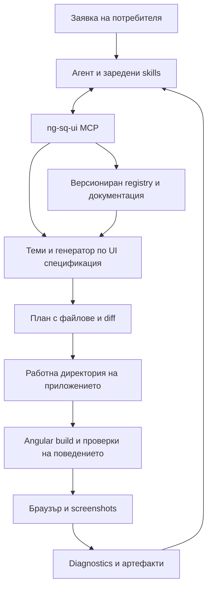

# План за MCP сървър за ng-sq-ui

Дата: 27 ноември 2026 г.

Локална реализация: [MCP workflow и стартиране](mcp/README.md). Резултати и оставащи проверки: [валидация на реализацията](mcp/validation.md).

Целта е агент да може да използва ng-sq-ui за изграждане на цялостна тема, отделен UI пример, страница или Angular приложение като админ панел. CoreUI и Taiga UI служат за ориентир за MCP функционалностите, документацията и skills. Генерираният интерфейс използва публичните API на ng-sq-ui.

Предложеният резултат е npm пакет `@sq-ui/mcp`, каталог с проверени API и примери, библиотека с композиции за страници и комплект `sq-ui-*` skills. Агентът превръща заявката в структурирана спецификация, а сървърът предоставя точните API, генерира файлове по проверени рецепти и връща резултати от компилация и браузърни проверки.

## Очаквано поведение

Примерна заявка:

> Изгради админ панел с ng-sq-ui, зелена бранд тема, светъл и тъмен режим, Dashboard, Users и Settings. Users да има търсене, филтри, сортиране, странициране и форма за редакция. Интерфейсът да работи и на телефон.

Агентът трябва да получи:

- Работещ Angular проект или промени в избрано съществуващо приложение.
- Тема с цветове, типография, размери, отстояния, състояния и режим light/dark/system.
- Навигация, маршрути, страници и свързани взаимодействия с детерминистични примерни данни.
- Пълни `.ts`, `.html` и `.scss` файлове, импорти, зависимости и инструкции за стартиране.
- Преглед в браузър, screenshots и отчет за build, поведение, адаптивност и достъпност.

Автентикацията, ролите и CRUD операциите могат да използват демонстрационни data providers. Свързването към реален backend е отделен договор с конкретни endpoints и правила за достъп.

## Налична основа в проекта

| Област | Налично | Използване в MCP |
| --- | --- | --- |
| Платформа | Angular 22, TypeScript 6, Node 24 в `.nvmrc`; седем библиотечни проекта | Сървърът има собствен Node build и използва същата поддържана среда |
| Версии | Локалните package manifests са `3.0.2` | Разделяне на локална версия, публикувана версия и версия в потребителския проект |
| Angular API | Standalone компоненти, signal inputs/outputs/models, Signal Forms | Генераторът използва потвърдените сигнатури за съответната версия |
| Каталог | 20 UI компонента и tooltip директива, варианти и живи примери | Начален списък за registry и първи сценарии за генериране |
| Генериране на код | Общ helper за setup и template на примерите | Разширяване до пълни компилируеми файлове |
| Стилове | Sass токени, CSS свойства `--sq-*`, scoped `.sq`, публични Sass exports | Основна инфраструктура за теми |
| Проверки | Vitest, lint, TypeScript, package/style проверки и Chrome скриптове | Основа за валидиране на генерирания резултат |

Основни източници в repository:

- [Каталог на компонентите](../src/app/catalog/component-catalog.ts) и [генериране на примерния код](../src/app/catalog/example-code.ts).
- [Публичен umbrella entry point](../projects/ng-sq-ui/src/index.ts) и публичните `src/index.ts` файлове на шестте съставни библиотеки.
- [Карта на токените](../projects/ng-sq-common/src/lib/styles/_token-values.scss), [публичен Sass API](../projects/ng-sq-common/src/lib/styles/tokens.scss) и [ръководство за стиловете](styling.md).
- [Настоящи проверки на примерите](../src/app/catalog/demo-example.component.spec.ts) и [проверки в браузър](../scripts/check-catalog-preview.mjs).

Каталогът съдържа demo metadata и не описва целия публичен API. Registry трябва да включи и типовете, услугите, директивите за templates, наследените inputs и secondary entry points. Сегашната проверка с `parseTemplate` установява валиден Angular синтаксис; генерираните файлове трябва допълнително да преминават пълна Angular компилация със strict template checking.

## Покритие спрямо CoreUI и Taiga UI

### MCP функционалности

Следните възможности са минималното функционално покритие. Имената от референтните сървъри служат за проследимост; ng-sq-ui може да обединява еднаквите операции.

| Референтен инструмент | Еквивалент за ng-sq-ui |
| --- | --- |
| CoreUI `list_components` | Каталог с категории, търсене, package и версия |
| CoreUI `search_docs` | Търсене в API, ръководства, примери и миграции |
| CoreUI `get_doc_page` | Markdown документ по идентификатор |
| CoreUI `get_component_api` | Структуриран API за inputs, outputs, models, templates и типове |
| CoreUI `get_cross_framework_links` | `get_reference_links`: действителни връзки към еквиваленти в референтните библиотеки, с изрично означение за framework и липсващо съответствие |

CoreUI публикува тези пет инструмента чрез `@coreui/docs-mcp`, с локален stdio транспорт и кеш на документацията. [Официална документация на CoreUI MCP](https://coreui.io/angular/docs/ai-tools/mcp/).

| Референтен инструмент | Еквивалент за ng-sq-ui |
| --- | --- |
| Taiga `get_overview` | Версия, import map, setup, правила за генериране и чести грешки |
| Taiga `get_list_components` | Същият каталог като `list_components`, включително приблизително съвпадение при търсене |
| Taiga `get_component_example` | Документация и пълен runnable пример за компонент или съставен интерфейс |
| Taiga `get_migration_guide` | Ръководство между конкретни версии с checklist и налични автоматизирани стъпки |

Taiga предоставя тези четири инструмента чрез `@taiga-ui/mcp`, избор на документационна версия и CLI инициализация за различни клиенти. [Официална документация на Taiga MCP](https://taiga-ui.dev/ai/mcp/).

Допълнително планираме `init --client <client>`, проверка на връзката, избор на версия, кеш с TTL, работа с пакетирана документация без интернет и обновяване към съвместим snapshot. Read-only документационният профил работи и без локален Angular проект.

Да се генерират `llms.txt`, `llms-full.txt` и Markdown страници от същия registry. Такива формати са част от AI документацията на [CoreUI](https://coreui.io/angular/docs/ai-tools/llms-txt/) и [Taiga UI](https://taiga-ui.dev/ai/overview/).

### Skills

Taiga има skills за работа с библиотеката, setup и миграции. CoreUI описва инсталация, няколко миграционни пътя, преход от Bootstrap, теми, utility API и създаване на компоненти. Описаните CoreUI v6 skills са за съответните пакети и версии; Angular еквивалентите за ng-sq-ui следват собствените му API. [Taiga skills](https://taiga-ui.dev/ai/skills/), [CoreUI skills](https://coreui.io/bootstrap/docs/6.x/ai-tools/skills/).

Skills за ng-sq-ui трябва да покрият тези работни процеси и създаването на завършени интерфейси:

| Skill | Отговорност |
| --- | --- |
| `sq-ui` | Начална ориентация, откриване на версия и избор на подходящ workflow |
| `sq-ui-setup` | Зависимости, standalone импорти, глобални стилове, `.sq`, опционални икони и шрифтове |
| `sq-ui-component` | Избор, използване и разширяване на компонент с публичните API и template slots |
| `sq-ui-forms` | Signal Forms, типизирани модели, валидация, disabled/touched/error състояния |
| `sq-ui-theme` | Бранд тема, семантични токени, типография, light/dark/system |
| `sq-ui-styling` | Scoped стилове, responsive helpers, Sass и премахване на ненужни локални правила |
| `sq-ui-layout` | Shell, sidebar, header, breadcrumbs и навигация на малък екран |
| `sq-ui-example` | Самостоятелен runnable пример с пълни файлове и примерни данни |
| `sq-ui-page` | Страница от проверени композиции с маршрути и състояния |
| `sq-ui-admin` | Цял админ панел с обща тема и свързани страници |
| `sq-ui-table` | Търсене, филтри, сортиране, странициране и действия върху редове |
| `sq-ui-overlays` | Modal, dropdown и tooltip; focus, Escape, scroll и наследяване на тема |
| `sq-ui-responsive` | Телефон, таблет и desktop, таблици, менюта и touch взаимодействия |
| `sq-ui-accessibility` | Имена, labels, клавиатура, focus, контраст и проверки с axe |
| `sq-ui-i18n` | Локализирани текстове, числа и дати; RTL layout и locale конфигурация |
| `sq-ui-migration` | Последователни и многоверсионни миграции, включително 2.x към 3.x |
| `sq-ui-adoption` | Замяна на Bootstrap, CoreUI, Taiga или собствен markup с проверени ng-sq-ui композиции |
| `sq-ui-validation` | Компилация, поведенчески проверки, browser preview и поправка по diagnostics |

Всеки `SKILL.md` описва кога се използва, последователност, нужните MCP инструменти, критерии за край и ограничения. Версионните API се четат от registry. Миграционните skills използват codemods само за еднозначни промени; останалите връщат конкретни задачи за агента. Новият компонентен код следва Angular lifecycle и signal contracts.

## Архитектура



Агентът управлява планирането и цикъла за поправки. MCP сървърът изпълнява операции с ясни входове и изходи. Това позволява еднакъв сървър да се използва от различни агенти без собствен задължителен LLM API ключ.

Предложен стек:

- TypeScript с отделен Node package под `tools/mcp-server` и собствен `tsconfig`.
- Официалния MCP TypeScript SDK v2, `@modelcontextprotocol/server`, и Zod за схемите. Към датата на плана SDK v2 е стабилната линия; конкретните версии се фиксират при реализацията. [Официален SDK](https://ts.sdk.modelcontextprotocol.io/v2/).
- Stdio за локалната първа версия. Streamable HTTP е следващ транспорт за отдалечени клиенти, със споделена логика и отделни workers за build/preview. [HTTP транспорт](https://ts.sdk.modelcontextprotocol.io/v2/serving/http.html).
- TypeScript compiler и Angular compiler за извличане и проверка на API и templates.
- JSON registry и локален текстов индекс. Семантично търсене може да се добави при доказана нужда.
- Playwright и axe за новите проверки; наличните Chrome скриптове остават полезни за компонентните сценарии.

Angular CLI MCP може да се свърже като допълващ сървър за Angular документация и workspace операции. ng-sq-ui MCP притежава знанията за библиотеката, темите и композициите. Изпълняващият агент координира двата сървъра. Текущият repository използва `npm test` за Vitest, затова runner трябва да отчита наличните npm scripts и Angular targets. [Angular CLI MCP](https://angular.dev/ai/mcp).

## Registry като общ източник

Registry се изгражда при build/release и се използва едновременно от demo, MCP, skills references и AI документацията.

Всеки компонентен запис съдържа:

- ID, selector, export name, каноничен package import, aliases и Angular compatibility.
- Inputs, outputs и models с типове, defaults, required flags, наследяване и генерирани two-way bindings.
- Projected content, template directives, context types и достъпни публични методи.
- Зависимости, styles, CSS tokens, икони и опционални assets.
- Примери, допустими варианти, responsive и accessibility contracts.
- Статус на поддръжка, известни ограничения, deprecations и миграционни връзки.
- Package version, source commit, schema version и хешове на източниците.

Извличането следва публичните entry points и техните exports. Angular и TypeScript анализът извлича сигнатурите; ръчно поддържаните metadata добавят семантика и recipes. Конфликт между документация, export и реализация създава diagnostic. Например Signal Forms пример трябва да се основава на действителния договор на контрола.

Версионният избор е детерминистичен: изрично зададена целева версия, след това инсталираните пакети и lockfile, след това зададен snapshot. Локалният source режим се избира изрично и се означава с commit. Липсваща версия връща грешка и наличните възможности. Ключът на кеша включва package, version и snapshot hash.

Началният генератор за примери се извежда от `src/app/catalog/example-code.ts` в споделен модул без Angular runtime зависимост. Angular demo и Node сървърът консумират еднакви данни и recipes. Проверка в CI следи дали всяка публична декларация има registry запис и дали всеки публикуван пример компилира.

## MCP интерфейс

### Документация и откриване

Каноничните read-only инструменти са `get_overview`, `list_components`, `search_docs`, `get_doc_page`, `get_component_api`, `get_component_example`, `get_migration_guide` и `get_reference_links`. Добавят се `list_tokens`, `get_theme` и `list_blueprints`.

`get_overview` връща също поддържаните операции, версии и ограничения на клиента. Филтрите включват package, категория, версия, тип декларация и support status. Големите списъци имат pagination; дългите документи се връщат на секции или като resource links.

### Планиране и генериране

| Инструмент | Вход | Резултат |
| --- | --- | --- |
| `inspect_workspace` | Регистриран workspace | Angular версия, зависимости, маршрути, стилове и налични проверки |
| `plan_ui` | Структуриран `UiSpec` | Компоненти, зависимости, файлове, липсващи възможности и план |
| `create_theme` / `update_theme` | Theme spec и целева версия | Версионирана тема и план за файловете |
| `generate_ui` | Валиден `UiSpec`, theme ID и blueprint версия | Changeset с пълни файлове и diff |
| `apply_changeset` | Changeset ID и очаквани хешове | Прилагане в workspace и запис на промените |
| `validate_ui` | Workspace или artifact ID, профил на проверките | Build, типове, поведение и diagnostics |
| `preview_ui` | Workspace/artifact и избрани viewport/theme | Preview адрес, screenshots и browser diagnostics |
| `export_artifact` | Artifact ID и формат | Папка или архив с приложение, тема или пример |
| `get_job` / `cancel_job` | Job ID | Статус, резултат или прекратяване на дълга операция |

`UiSpec` има режим `theme`, `example`, `page` или `application`. Blueprint е проверена рецепта с фиксиран договор за компоненти, данни, файлове и взаимодействия. Агентът формулира спецификацията; генераторът я проверява и изпълнява. За custom layout агентът разширява генерирания код и го подава отново за валидация.

Примерен вход за приложение:

```json
{
  "schemaVersion": 1,
  "mode": "application",
  "target": {
    "angularMajor": 22,
    "sqUiVersion": "3.0.2",
    "sourceMode": "workspace"
  },
  "blueprint": "admin-basic",
  "theme": {
    "brand": "#00c474",
    "modes": ["light", "dark", "system"],
    "density": "comfortable"
  },
  "locale": "bg-BG",
  "pages": [
    { "id": "dashboard", "recipe": "dashboard-summary" },
    {
      "id": "users",
      "recipe": "crud-list",
      "features": ["search", "filter", "sort", "paginate", "edit"]
    },
    { "id": "settings", "recipe": "settings-form" }
  ],
  "dataProvider": "mock",
  "output": { "mode": "new-project", "directory": "examples/admin-basic" }
}
```

Всички инструменти имат input/output JSON Schema и структурирани грешки. Генериращият резултат включва `artifactId`, `changesetId`, версии, списък на файловете, зависимости и diagnostics. Валидиращият резултат съдържа статус на всяка проверка, командата, изходния код, runtime/viewport и връзки към артефактите. Статусите са `passed`, `failed` и `not-run`.

### Resources, prompts и skills

Предложени resource templates:

```text
sq-ui://versions/{version}/overview
sq-ui://versions/{version}/components/{component}
sq-ui://versions/{version}/examples/{example}
sq-ui://versions/{version}/tokens
sq-ui://themes/{themeId}
sq-ui://blueprints/{blueprintId}
sq-ui://artifacts/{artifactId}/report
```

Prompts като `build-example`, `build-page`, `build-admin`, `customize-theme` и `migrate-project` предоставят удобни начални инструкции. Skills съдържат дългосрочния workflow и се доставят като `SKILL.md` директории за клиентите, които ги зареждат локално.

SDK v2 предоставя и skills extension с `skills/list` и проверими файлове чрез resources. Интеграцията `attach` е experimental, затова поддръжката се договаря с клиента и има fallback към пакетирани skills и обикновени documentation resources. [SDK skills extension](https://ts.sdk.modelcontextprotocol.io/v2/servers/skills.html).

Progress, cancellation и notifications се включват според договорените capabilities. При по-дълги build/preview операции се използват jobs с явен статус. Решението работи с обичайния цикъл от tool calls на агента.

## Генериране на цялостни теми

Темата обхваща палитра, семантични роли, типография, spacing, радиуси, сенки, focus, плътност и състоянията на компонентите. Layout recipes използват същите токени за shell, sidebar, header и съдържание.

1. Да се извлече schema за наличните Sass/CSS токени, с тип, default, предназначение и потребители.
2. Да се дефинират светъл и тъмен набор от семантични стойности и връзката им с бранд палитрата.
3. Да се генерират `theme.json`, `theme.scss`, CSS custom properties и Angular интеграция за режима.
4. Да се поддържат light/dark/system, запомнен избор и безопасна начална стойност при SSR.
5. Да се проверят вложените `.sq` контейнери, overlay елементите и изолацията на стиловете.
6. Да се проверят контрастът и default/hover/focus/active/disabled/error/selected състоянията.

Наличните runtime токени са добра основа. Пълен dark preset изисква проверка на всеки компонент. Промяната на `color-brand` не преизчислява автоматично всички независими selection/shadow/range стойности; генераторът трябва да задава и валидира целия нужен набор. [Текущ договор за темите](styling.md#override-compiled-components-at-runtime).

## Примери, страници и админ панел

Генерирането се развива на четири нива:

| Ниво | Примери | Договор |
| --- | --- | --- |
| Компонент | Input с validation, dropdown, modal | Пълни импорти, model, events, styles и runnable host |
| Композиция | Filter toolbar, CRUD table, settings section | Свързани данни, callbacks и състояния |
| Страница | Login, users list, detail/edit, settings | Маршрут, layout и loading/empty/error/success |
| Приложение | Админ панел | Общ shell, тема, навигация, страници и data providers |

Първият admin blueprint включва Dashboard, Users, User detail/edit, Settings, демонстрационен Login и 404. Dashboard има summary cards и activity list; графиките се включват само чрез деклариран chart provider. Users има работещи търсене, филтри, сортиране, странициране, редакция и потвърждение за изтриване. Промените в примерните данни се виждат последователно в списъка и detail екрана.

При добавяне в съществуващо приложение генераторът използва AST промени за импорти и маршрути, отчита наличната организация на проекта и предотвратява дублирани глобални style imports. Повторно изпълнение със същия spec трябва да е идемпотентно. Промяна на темата пази логиката на страниците.

### Допълнения в самата библиотека

За всяка рецепта се поддържа capability запис със статус `native`, `composition`, `external`, `planned` или `unsupported`. Registry прави разлика между способност на ng-sq-ui и логика, предоставена от страницата.

| Област | Начална реализация | Допълнение |
| --- | --- | --- |
| Sidebar, header и breadcrumbs | Navbar и demo shell | Публична проверена shell композиция с mobile навигация |
| Dashboard cards | Наличен CardComponent | Summary и activity recipes |
| CRUD таблица | Datatable и paginator, включително сортиране | Search/filter/CRUD в page recipe; отделен договор за server data |
| Форми | Налични контроли и Signal Forms | Composite forms, submit/error flow и локализирани съобщения |
| Modal | Наличен компонент с projected sections | Initial focus, focus trap, restoration и scroll lock |
| Дати | Налични date/time контроли | Проверка и допълване на keyboard/locale договора |
| Dark mode | Налични runtime токени | Пълен preset и проверка на всички states |
| Alerts, toast, tabs, badge, skeleton, drawer | Отделни recipes или нови компоненти след inventory | Явни публични договори и проверено поведение |
| Charts, upload, tree, virtualized grid | Деклариран provider или нов пакет | Отделна оценка на необходимостта и реализацията |
| I18n, RTL и SSR | Анализ на текущите компоненти | Тестови приложения и проверки преди обявяване на поддръжка |

По-старият [отчет за валидация](style-migration/phase-6-validation.md#remaining-work-before-complete-design-sign-off) описва ограничения при modal и calendar. Те се проверяват срещу текущия код и се затварят преди recipes да заявяват пълно покритие за съответното взаимодействие.

„Всички функционалности“ се проследява чрез versioned матрица: референтен workflow → ng-sq-ui capability → tool/skill → приемателен сценарий. MCP покритието и броят реализирани UI компоненти се измерват отделно. Новите компоненти в CoreUI/Taiga влизат като видима промяна в тази матрица при обновяване на референтния snapshot.

## Работа с файлове и процеси

Документационният профил използва пакетирания registry. Build профилът работи с изрично зададен workspace и операции по artifact/changeset ID.

- File paths се ограничават до canonical workspace root, включително проверки за symlinks.
- Генерирането първо връща changeset; прилагането проверява базовите хешове и запазва чуждите промени.
- Зависимостите се връщат като план. Инсталирането им следва активната политика на изпълняващия клиент.
- Build и preview използват определени executables и argument arrays, timeouts и управление на child процесите.
- Външна документация и примерни данни се третират като входни данни. Командите и paths идват от доверената конфигурация.
- Протоколът използва stdout, а диагностичните логове — stderr.
- При HTTP се добавят проверка на идентичност, workspace/artifact изолация и Host/Origin проверки пред endpoint. Preview адресите и файловете се управляват отделно от MCP endpoint.

Тези правила се реализират в общия runner и changeset layer, за да имат всички инструменти еднакво поведение.

## Структура на реализацията

```text
tools/
  mcp-server/              # npm package @sq-ui/mcp, CLI и transports
    src/
      tools/
      resources/
      prompts/
      jobs/
      server.ts
    package.json
    tsconfig.json
  ui-registry/             # Извличане, schema и версионирани данни
  ui-generator/            # UiSpec, recipes, themes и changesets
  ui-validation/           # Build runner, browser и accessibility
skills/
  sq-ui/
    SKILL.md
  sq-ui-setup/
    SKILL.md
  ...
examples/
  generated/               # Игнорирани локални резултати
  fixtures/                # Малки проверявани consumer приложения
docs/
  mcp-server-plan.md
  mcp/                     # Setup, tool API и guides
```

Създава се един публичен server package с пакетирани registry данни и skills. Вътрешните modules първоначално могат да се компилират в него, без допълнителни публикувани npm пакети. Новият Node build остава отделен от `ng-packagr` и Angular browser bundle.

`dist/` се използва от настоящите library builds, а `npm start` го изтрива чрез `prestart`. MCP artifacts и кешове трябва да имат собствена директория извън този изтриван output. За preview на проверен production build може да се използва наличният `scripts/serve-built-preview.mjs`.

## Етапи и резултати

Ориентир за един разработчик с опит в Angular и TypeScript: 35–45 работни дни за пълния основен workflow, с допускане за използване на наличните компоненти и описаните критични поправки. Таблицата разпределя 35 дни работа; останалите до 10 дни са резерв за component contracts и интеграционни проблеми. Оценката се актуализира след inventory; големи нови UI пакети имат отделен backlog.

| Етап | Зависимост | Работа | Приемане | Ориентир |
| --- | --- | --- | --- | --- |
| 0 | — | Inventory на публичните API, tools и skills; фиксиране на reference snapshots и UiSpec v1 | Матрица с всеки workflow, версия и тестов сценарий | 2 дни |
| 1 | 0 | Registry extractor, споделен example generator и CI проверка за покритие | Всеки public export е описан; всички catalog примери компилират | 5 дни |
| 2 | 1 | Stdio server, документационни tools, resources, CLI init и AI docs | Функционално покритие на двата референтни MCP сървъра | 4 дни |
| 3 | 2 | Theme generator, light/dark/system и основни setup/theme/component skills | Една тема работи върху целия компонентен каталог | 5 дни |
| 4 | 3 | Генериране на example/page, UiSpec, changesets и първи composite recipes | Working form, CRUD list и settings page в consumer проект | 7 дни |
| 5 | 4 | Admin blueprint, навигация, общи данни, responsive поведение и останалите skills | Пълният admin сценарий работи през агент | 8 дни |
| 6 | 5 | Client проверки, browser/a11y gates, package проверка и release документация | Възпроизводима инсталация и всички приемателни сценарии | 4 дни |

Работата по modal focus и необходимите component contracts се включва преди зависимите recipes. Skills се добавят със съответния проверен workflow. Началната вертикална демонстрация е `input + validation → theme → generated component → Angular build → browser preview`.

Предложени версии: `0.1` за документационното MCP покритие, `0.2` за теми и самостоятелни UI примери и `1.0` за пълния admin workflow. Отдалеченият HTTP transport е последваща възможност с отделни operational проверки.

## Проверки и критерии за завършеност

### MCP и registry

- Връзка, discover и безопасно извикване от поне два различни MCP клиента.
- Schema проверки, pagination, неизвестни IDs, липсващи версии, cache invalidation и cancellation.
- Документационният профил работи без Angular workspace и с изключена мрежа.
- Всеки public export и recipe има versioned запис; липса или конфликт блокира release.
- Всички налични catalog варианти се генерират като пълни standalone компоненти и преминават strict Angular компилация.

### Генериран UI

- Production build без грешки и без несъществуващи exports/inputs.
- Работещи филтри, сортировка, странициране, edit/save/cancel и validation, включително празен резултат и грешка.
- Проверки на 320, 390, 768 и 1440 px; хоризонталният scroll е ограничен до изрично планирани области.
- Light, dark и system режим, запазен избор и правилна тема в overlays.
- Реална клавиатурна проверка на менюта, dropdowns и dialogs; axe отчет плюс ръчна проверка на focus и четимостта.
- Chromium за всички сценарии; Firefox и WebKit smoke проверки за основните form/date/navigation сценарии.
- Повторно генериране без дублирани импорти, маршрути и styles; защита на потребителски промени.

### Проверки на repository и пакета

Използват се `npm run build:libs`, след него `npm run check:exports`, `npm run check:styles` и `npm run typecheck`, както и `npm run lint`, `npm test` и `npm run build`. Добавят се отделни проверки за Node server package и UI generation fixtures. `npm pack` и инсталация в чист consumer потвърждават, че registry, skills, templates и styles присъстват в пакета.

Резултатът за `1.0` е завършен, когато агент може от една заявка да изгради описания admin панел, да промени бранда и режима му, да добави още една страница и да върне работещи файлове с проверим отчет. Матрицата за всички базови MCP и skill workflows трябва да е покрита, а всяка допълнителна UI възможност да има точен support status.
