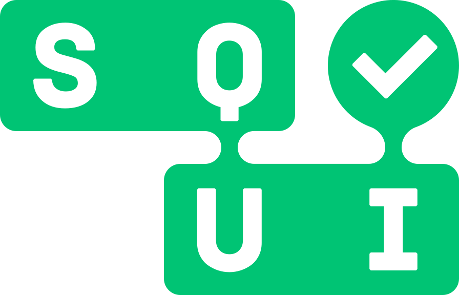

# Responsive navbar

`NavbarComponent` is a standalone component exported by `@sq-ui/ng-sq-common`
and `@sq-ui/ng-sq-ui`. It uses the project's colors and typography and includes
its own styles, so it also works without a `.sq` wrapper.

<div class="docs-preview" data-demo-preview="navbar">
  <div class="docs-preview-toolbar"><span>Live preview</span><a href="https://sq-ui.dev/#/embed/navbar" target="_blank" rel="noopener">Open example ↗</a></div>
  <iframe src="https://sq-ui.dev/#/embed/navbar" title="Responsive navbar interactive preview" loading="lazy" height="560"></iframe>
</div>

## Configure menu items

```typescript
import { Component, signal } from '@angular/core';
import { NavbarComponent, type NavbarItem } from '@sq-ui/ng-sq-common';

@Component({
  selector: 'app-navigation',
  imports: [NavbarComponent],
  template: `
    <sq-navbar brand="My workspace" brandHref="/" [items]="items()"
               (itemSelected)="select($event)"></sq-navbar>
  `,
})
export class NavigationComponent {
  readonly items = signal<NavbarItem[]>([
    { id: 'home', label: 'Home', href: '/', active: true },
    { id: 'features', label: 'Features', href: '/features' },
    { id: 'settings', label: 'Settings' },
    { id: 'help', label: 'Help', href: 'https://example.com/help', target: '_blank' },
    { id: 'coming-soon', label: 'Coming soon', disabled: true },
  ]);

  select(item: NavbarItem): void {
    // Items without href are action buttons: open a panel, navigate with your
    // router, or perform another application action here.
    if (!item.href) {
      this.items.update(items => items.map(entry => ({
        ...entry, active: entry.id === item.id,
      })));
    }
  }
}
```

Assign a new array (or update a signal) to change items at runtime. Each `id` must
be unique within a navbar. `href` items are native links, including normal
new-tab behavior. Items with neither `href` nor `routerLink` are action buttons.
For native links and action buttons, the caller owns `active`.

## Angular Router and automatic active links

Use `routerLink` for navigation without a page reload. The navbar applies its
active style and `aria-current="page"` automatically using Angular's
`RouterLinkActive`. It stays in sync when navigation comes from a different
component, a direct URL, or browser Back/Forward. No `itemSelected` handler or
manual `active` updates are needed for router items.

Your app must provide Angular Router, and `@angular/router` 22.x is a peer
dependency of `@sq-ui/ng-sq-common`.

```typescript
import { Component } from '@angular/core';
import { bootstrapApplication } from '@angular/platform-browser';
import { provideRouter, RouterOutlet } from '@angular/router';
import { NavbarComponent, type NavbarItem } from '@sq-ui/ng-sq-common';

@Component({ template: '<h1>Workspace overview</h1>' })
class OverviewPage {}

@Component({ template: '<h1>Workspace settings</h1>' })
class SettingsPage {}

@Component({
  selector: 'app-root',
  imports: [NavbarComponent, RouterOutlet],
  template: `
    <sq-navbar brand="My workspace" [items]="items"></sq-navbar>
    <router-outlet></router-outlet>
  `,
})
class AppComponent {
  readonly items: NavbarItem[] = [
    { id: 'overview', label: 'Overview', routerLink: '/workspace' },
    { id: 'settings', label: 'Settings', routerLink: ['/workspace', 'settings'] },
    { id: 'help', label: 'Help', href: 'https://example.com/help', target: '_blank' },
  ];
}

bootstrapApplication(AppComponent, {
  providers: [provideRouter([
    { path: 'workspace/settings', component: SettingsPage },
    { path: 'workspace', component: OverviewPage },
    { path: '', redirectTo: 'workspace', pathMatch: 'full' },
  ])],
});
```

Routes match exactly by default, so Overview is not active on
`/workspace/settings`. Set `exact: false` on a parent link when it should also
stay active on child routes. Exact matching also compares query parameters;
use `queryParams` to distinguish tabs on the same path, and `fragment` to set a
URL fragment. Fragment differences do not affect the active state. If both link
properties are supplied, `routerLink` takes precedence over `href`. For router
items, `active` is ignored in favor of the actual route match.

The **Angular Router** section of the live preview demonstrates query-parameter
tabs on the current demo route. Selecting a tab updates the URL, content and
active link together; browser Back and Forward restore the previous tab.

## Inputs and output

| Property | Default | Behavior |
|---|---|---|
| `items` | `[]` | Readonly array of `NavbarItem` objects |
| `brand` | `'SQ UI'` | Default brand text |
| `brandHref` | `'/'` | Default brand link |
| `ariaLabel` | `'Main navigation'` | Accessible name of the navigation landmark |
| `expanded` | `false` | Two-way model for mobile expansion, e.g. `[(expanded)]="menuOpen"` |
| `itemSelected` | — | Emits the enabled `NavbarItem` selected by the user |

`NavbarItem` has required `id` and `label`, and optional `href`, `routerLink`
(string or readonly command array), `queryParams`, `fragment`, `exact` (default `true`), `target`
(`'_self'` or `'_blank'`), `icon` (consumer-provided icon classes), `active`, and
`disabled`. Disabled items cannot navigate, receive focus or emit selection.

## Branding and actions

Project custom branding and controls into these slots:

```html
<sq-navbar [items]="items()">
  <a sq-navbar-brand href="/" aria-label="Home">
    
  </a>
  <button sq-navbar-actions type="button" (click)="signIn()">Sign in</button>
</sq-navbar>
```

The brand slot replaces the default brand link. Projected actions remain under
the consumer's control. The navbar does not load an icon font or logo for you.

## Mobile behavior and styling

At viewport widths **768px and below**, the toggle expands and collapses the
menu using a grid-height and opacity animation. The menu grows with its content;
it has no fixed height limit. The hamburger changes to an X. Users who request
reduced motion get the same layout without animation.

The toggle exposes `aria-expanded` and `aria-controls`. The collapsed menu is
inert, so hidden links and projected actions are excluded from keyboard focus.
Escape and item selection close the menu and return focus to its toggle. Clicking
outside closes it while preserving focus on the outside control. On desktop the
menu remains visible, independently of the mobile `expanded` model.

Colors and fonts inherit the shared `--sq-color-*` and `--sq-font-family-sans`
tokens. The desktop layout wraps when space is constrained. Mobile expansion is
based on viewport width, including the iframe viewport in this live example.

See `/#/preview` under **Navigation**, or open the
[standalone navbar example](https://sq-ui.dev/#/embed/navbar).
